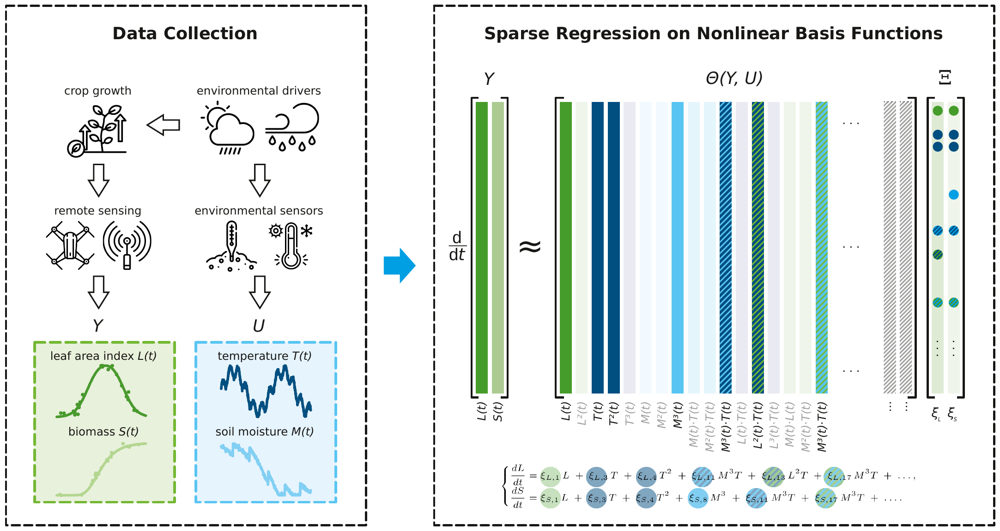
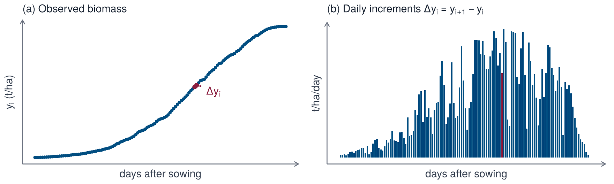
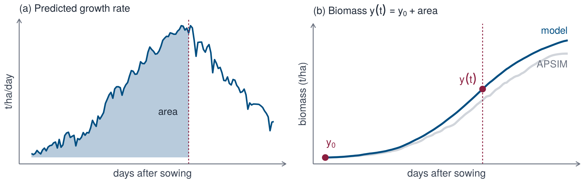
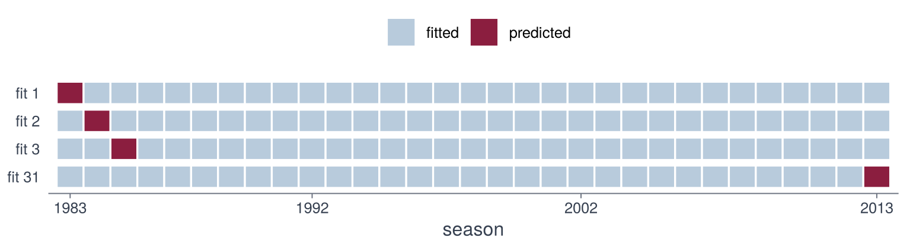

## Overview

{width=100%}

## Model

Let $\mathbf{y}(t)$ denote the state of the crop (for example biomass or leaf area index) and $\mathbf{u}(t) = (u_1(t), \dots, u_m(t))$ the environmental drivers. The dynamics are written as a system of ordinary differential equations

$$
\dot{\mathbf{y}} = \mathbf{f}(\mathbf{y}, \mathbf{u}).
$$

Each component $\dot{y}$ of the right-hand side is expressed as a combination of candidate functions $\theta_1, \dots, \theta_K$ (the library),

$$
\dot{y} = \sum_{j=1}^{K} \xi_j\,\theta_j(\mathbf{y}, \mathbf{u}) = \boldsymbol{\theta}(\mathbf{y}, \mathbf{u})^\top \boldsymbol{\xi},
$$

where most coefficients $\xi_j$ are expected to be zero. The library contains, for example, a constant, powers of the drivers and of the states, and products of them.

The three panels show how the environment drives growth. Temperature (a) enters a response function (b); the resulting growth rate is accumulated over the season to give biomass (c). Press play, or move the day slider, to follow one day through the panels. The optimum and the upper limit change the shape of the response, and the dashed curves show the default response for comparison.

```{ojs}
//| echo: false
d3 = window.d3
Plot = window.Plot
weather = FileAttachment("data/interactive/weather.json").json()
viewof year = select("Season", weather.years, 1998)
viewof optimum = knob("Optimum (°C)", d3.range(10, 26.5, 0.5), 20, v => v.toFixed(1))
viewof limit = knob("Upper limit (°C)", d3.range(26, 41, 1), 35, v => v.toFixed(0))
viewof day = player("Day", d3.range(150), 60, i => weather.das0 + i)
```

```{ojs}
//| echo: false
toy = {
  const base = 2, rmax = 0.17;                    // °C, t/ha/day
  const logistic = x => 1 / (1 + Math.exp(-x));
  const canopy = das => logistic((das - 55) / 10) * (1 - logistic((das - 130) / 6));
  const response = (u, opt, top) => (u <= base || u >= top) ? 0 :
    (top - u) / (top - opt) * Math.pow((u - base) / (opt - base), (opt - base) / (top - opt));
  const u = weather.temperature[weather.years.indexOf(+year)].slice();
  const das = d3.range(u.length).map(i => weather.das0 + i);
  const trajectory = (opt, top) => {
    let y = 0;
    return u.map((v, i) => (y += rmax * response(v, opt, top) * canopy(das[i])));
  };
  return {u, das, response, canopy, rmax,
          y: trajectory(optimum, limit), ref: trajectory(20, 35)};
}
```

```{ojs}
//| echo: false
{
  const {u, das, response, canopy, rmax, y, ref} = toy;
  const rows = (v, from, to) => d3.range(from, to).map(i => ({das: das[i], v: v[i]}));
  const style = {fontSize: "10px"};
  const n = u.length, d = Math.min(day, n - 1), last = weather.das0 + 149;
  const blue = "#014E81", faint = "#D1D5DB", red = "#8B1E3F";
  const temperature = Plot.plot({
    width: 228, height: 230, style, marginLeft: 38,
    x: {label: "days after sowing", domain: [weather.das0, last]},
    y: {label: "temperature (°C)", domain: [0, 30]},
    marks: [Plot.line(rows(u, 0, n), {x: "das", y: "v", stroke: faint}),
            Plot.line(rows(u, 0, d + 1), {x: "das", y: "v", stroke: blue, strokeWidth: 1.5}),
            Plot.dot([{das: das[d], v: u[d]}], {x: "das", y: "v", fill: red, r: 5})]
  });
  const grid = d3.range(0, 40.01, 0.25);
  const curve = (opt, top) => grid.map(g => ({u: g, r: response(g, opt, top)}));
  const rate = rmax * response(u[d], optimum, limit) * canopy(das[d]);
  const responsePlot = Plot.plot({
    width: 228, height: 230, style, marginLeft: 38,
    x: {label: "temperature (°C)", domain: [0, 40]},
    y: {label: "relative response", domain: [0, 1.05]},
    marks: [Plot.ruleX(u, {y1: 0, y2: 0.04, stroke: "#9CA3AF", strokeOpacity: 0.5}),
            Plot.line(curve(20, 35), {x: "u", y: "r", stroke: "#9CA3AF", strokeDasharray: "4 3"}),
            Plot.line(curve(optimum, limit), {x: "u", y: "r", stroke: blue, strokeWidth: 2}),
            Plot.ruleX([u[d]], {y1: 0, y2: response(u[d], optimum, limit), stroke: red, strokeOpacity: 0.4}),
            Plot.dot([{u: u[d], r: response(u[d], optimum, limit)}], {x: "u", y: "r", fill: red, r: 5})]
  });
  const growth = Plot.plot({
    width: 228, height: 230, style, marginLeft: 38,
    x: {label: "days after sowing", domain: [weather.das0, last]},
    y: {label: "biomass (t/ha)", domain: [0, 14]},
    marks: [Plot.line(rows(ref, 0, n), {x: "das", y: "v", stroke: "#9CA3AF", strokeDasharray: "4 3"}),
            Plot.line(rows(y, 0, n), {x: "das", y: "v", stroke: faint, strokeWidth: 2}),
            Plot.line(rows(y, 0, d + 1), {x: "das", y: "v", stroke: blue, strokeWidth: 2}),
            Plot.line(rows(y, Math.max(0, d - 1), d + 1), {x: "das", y: "v", stroke: red, strokeWidth: 4}),
            Plot.dot([{das: das[d], v: y[d]}], {x: "das", y: "v", fill: red, r: 5})]
  });
  return html`<div style="display:flex;flex-wrap:wrap;gap:.3rem">${temperature}${responsePlot}${growth}</div>
    <p class="interactive-note">Day ${das[d]}: ${u[d].toFixed(1)} °C gives a relative response of ${response(u[d], optimum, limit).toFixed(2)} and a growth rate of ${rate.toFixed(3)} t/ha/day.</p>`;
}
```

Temperature is the observed daily mean at Narrabri (3-day average). The response is an asymmetric function of temperature with base temperature 2 °C, and the growth rate is 0.17 t/ha/day times the response times a canopy factor that rises with leaf area and falls at senescence. The figure is a toy: the growth rate depends on temperature only.


In this workshop the state is a single quantity, biomass $y$, and the library contains functions of the drivers only, so that the growth rate depends on the environment but not on the current biomass. Libraries that contain the state are treated in step 9.

## Regression

Let $y_i = y(t_i)$ be observations on consecutive days. The increments $\Delta y_i = y_{i+1} - y_i$ approximate $\dot{y}(t_i)$ for a time step of one day.

{width=100%}

 Collecting the increments in a vector $\Delta\mathbf{y}$ and the library values in a matrix $\mathbf{X}$ with entries $X_{ij} = \theta_j(\mathbf{y}_i, \mathbf{u}_i)$ gives

$$
\Delta\mathbf{y} \approx \mathbf{X}\boldsymbol{\xi}.
$$

The coefficients enter linearly, so they can be estimated by regression, for example by least squares

$$
\hat{\boldsymbol{\xi}} = \arg\min_{\boldsymbol{\xi}} \; \lVert \Delta\mathbf{y} - \mathbf{X}\boldsymbol{\xi} \rVert_2^2 .
$$

Any regression method can be used. Step 4 compares several.

## Sparsity

A short equation is easier to interpret and less prone to overfitting than one with many terms. Sparsity is obtained by regression methods that set coefficients to zero: thresholding of small coefficients (sequential thresholded least squares, the original SINDy algorithm), an $\ell_1$ penalty (lasso), or subset selection. The number of retained terms balances accuracy and complexity and is chosen by validation.

## Solution

Given $\hat{\boldsymbol{\xi}}$ and the drivers, the equation is solved forward in time from an initial value $y_0$ with the same one-day step,

$$
y_{i+1} = y_i + \boldsymbol{\theta}(\mathbf{y}_i, \mathbf{u}_i)^\top \hat{\boldsymbol{\xi}} .
$$

If the library depends on the drivers only, this is a cumulative sum, $y_i = y_0 + \sum_{s<i} \boldsymbol{\theta}(\mathbf{u}_s)^\top \hat{\boldsymbol{\xi}}$, and no ODE solver is needed.

{width=100%}

## Genotypes

Each genotype $g$ has its own coefficient vector $\boldsymbol{\xi}_g$, estimated from the trajectories of that genotype in all available seasons.

## Validation

The independent units are seasons, since the weather of neighbouring days is strongly correlated. The model of a genotype is validated by leave-one-season-out cross-validation: each season is predicted from a model fitted to the other seasons and compared with the observed trajectory.

{width=85%}

## Steps

| Step | |
|---|---|
| [2 · Data](02-data.html) | drivers and trajectories |
| [3 · Library and design matrix](03-design.html) | $\boldsymbol{\theta}$, $\mathbf{X}$ and $\Delta\mathbf{y}$ |
| [4 · Fitting](04-fitting.html) | estimation of $\boldsymbol{\xi}$ |
| [5 · Validation](05-validate.html) | solution and cross-validation |
| [6 · Interpretation](06-reading.html) | response curves |
| [7 · Genotypes](07-genotypes.html) | equations of different genotypes |
