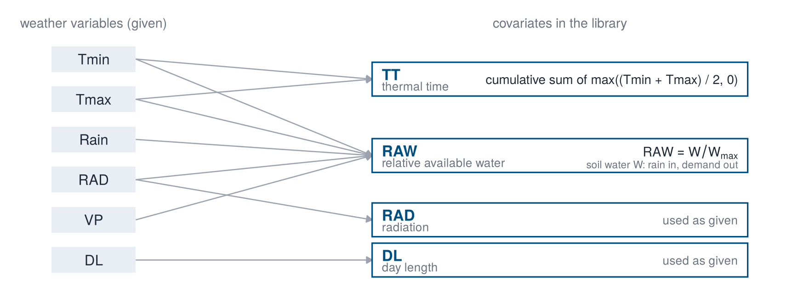

```{r}
#| echo: false
source("R/page_setup.R")
```

We demonstrate SINDy using an [APSIM simulation dataset](https://figshare.com/articles/dataset/24843705) of wheat (Bustos-Korts et al., 2019). The dataset contains daily biomass trajectories of 199 genotypes in 31 seasons (1983 to 2013) at Narrabri (New South Wales). The trajectories are generated by APSIM, a crop growth model, and are influenced by weather conditions, which are the same for all genotypes within a season.

{width=100%}

::: {.panel-tabset group="language"}

## R

```{r}
#| label: 02-1
#| ref.label: 02-1-run
#| eval: false
```

## Python

```python
import matplotlib.pyplot as plt
import numpy as np
import pandas as pd
from dgxe import *

wx = pd.read_csv("data/narrabri_weather.csv")
traj = pd.read_csv("data/narrabri_biomass.csv.gz")
print(wx.head(3))
print(traj.head(3))
```

:::

```{r}
#| label: 02-1-run
#| echo: false
wx <- read.csv("data/narrabri_weather.csv")
traj <- read.csv("data/narrabri_biomass.csv.gz")
head(wx, 3)
head(traj, 3)
```

## Weather variables

The weather table has one row per day and season, with the season (`year`), the days after sowing (`das`) and the following given variables.

| Variable | Description |
|---|---|
| `Tmin`, `Tmax` | daily minimum and maximum temperature (°C) |
| `Rain` | rainfall (mm) |
| `RAD` | solar radiation (MJ m⁻² d⁻¹) |
| `VP` | vapour pressure (hPa) |
| `DL` | day length (h) |

The table also contains two covariates that were constructed from these variables: `TT` and `RAW`.

## Covariates

Crop growth does not respond to the weather variables directly but to quantities derived from them. The library uses four covariates: thermal time, day length, relative available water and radiation. Two of them are constructed from the weather variables.

{width=90%}

**Thermal time** (`TT`) measures the development of the crop. It is the cumulative sum of the thermal time of each day, the mean temperature truncated at zero:

$$
\mathrm{TT}_t = \sum_{s \le t} \max\left(\frac{T_{\min,s} + T_{\max,s}}{2},\, 0\right).
$$

The sum starts at sowing, so `TT` on the first day in the table (day 15) already contains the first 14 days. The code below recomputes the sum within each season and compares it with the given column; the two differ by a constant per season, the thermal time of the first 14 days, so the spread of the difference within a season is zero.

::: {.panel-tabset group="language"}

## R

```{r}
#| label: 02-2
#| ref.label: 02-2-run
#| eval: false
```

## Python

```python
daily = ((wx["Tmin"] + wx["Tmax"]) / 2).clip(lower=0)  # thermal time per day
tt = daily.groupby(wx["year"]).cumsum()                # summed within a season
before = wx["TT"] - tt                                 # first 14 days
print(round(before.groupby(wx["year"]).std().max(), 6))
```

:::

```{r}
#| label: 02-2-run
#| echo: false
daily <- pmax((wx$Tmin + wx$Tmax) / 2, 0)  # thermal time per day
tt <- ave(daily, wx$year, FUN = cumsum)    # summed within a season
before <- wx$TT - tt                       # first 14 days
round(max(tapply(before, wx$year, sd)), 6)
```

**Relative available water** (`RAW`) describes the water status of the soil. In a soil-water balance, rainfall $P_t$ adds water and the evaporative demand $E_t$ removes it, up to the capacity $W_{\max}$ of the soil:

$$
W_t = \min\bigl(\max(W_{t-1} + P_t - E_t,\, 0),\, W_{\max}\bigr), \qquad \mathrm{RAW}_t = \frac{W_t}{W_{\max}}.
$$

The soil parameters and the evaporative demand come from the crop model, so `RAW` is used as given. Unlike the other covariates, it depends on the weather of the preceding days. Radiation and day length are used as given. Other constructions are possible, for example the vapour pressure deficit from `Tmax`, `Tmin` and `VP`; the library of this workshop is restricted to the four covariates above.

## Library drivers

The four covariates, for all seasons (grey) and three selected seasons:

::: {.panel-tabset group="language"}

## R

```{r}
#| label: 02-3
#| ref.label: 02-3-run
#| eval: false
```

## Python

```python
seasons = [1984, 1998, 2008]
fig, axes = plt.subplots(2, 2, figsize=(8, 5), sharex=True)
for ax, name in zip(axes.flat, DRIVERS):
    for year, g in wx.groupby("year"):
        ax.plot(g["das"], g[name], color=GREY, lw=0.25)
    for year, colour in zip(seasons, [BLUE, CYAN, BURGUNDY]):
        g = wx[wx["year"] == year]
        ax.plot(g["das"], g[name], color=colour, lw=0.9, label=year)
    ax.set_title(name, loc="left")
axes[0, 0].legend(frameon=False)
fig.supxlabel("days after sowing")
fig.tight_layout()
```

:::

```{r}
#| label: 02-3-run
#| echo: false
#| fig-height: 3.2
drivers <- c("TT", "DL", "RAW", "RAD")
w <- data.frame(
    year = wx$year, das = wx$das,
    driver = factor(rep(drivers, each = nrow(wx)), drivers),
    value = unlist(wx[drivers])
)
shown <- w[w$year %in% c(1984, 1998, 2008), ]

ggplot(w, aes(das, value, group = year)) +
    geom_line(colour = "#D1D5DB", linewidth = 0.25) +
    geom_line(data = shown, aes(colour = factor(year)), linewidth = 0.7) +
    facet_wrap(~driver, scales = "free_y") +
    scale_colour_dgxe("blue", "cyan", "burgundy") +
    labs(x = "days after sowing", y = NULL) +
    theme_dgxe() +
    legend_top()
```

## Response

The response is the biomass (t/ha) of each genotype. Each panel is one season: all 199 genotypes in grey and three genotypes with the lowest, median and highest final biomass in colour.

::: {.panel-tabset group="language"}

## R

```{r}
#| label: 02-4
#| ref.label: 02-4-run
#| eval: false
```

## Python

```python
drv = make_drivers(wx)
tr = make_trajectories(traj, drv)
three = spread_genotypes(tr)
days = np.arange(tr.Y.shape[2]) + tr.das0

fig, axes = plt.subplots(1, 4, sharey=True, figsize=(10, 2.8))
for ax, year in zip(axes, [1984, 1990, 1998, 2008]):
    s = list(tr.years).index(year)
    ax.plot(days, tr.Y[:, s].T, color=GREY, lw=0.2)
    for g, colour in zip(three, [BURGUNDY, CYAN, BLUE]):
        ax.plot(days, tr.Y[np.searchsorted(tr.genotypes, g), s],
                color=colour, lw=0.9, label=g)
    ax.set_title(year, loc="left")
axes[0].legend(frameon=False)
axes[0].set_ylabel("biomass (t/ha)")
fig.supxlabel("days after sowing")
fig.tight_layout()
```

:::

```{r}
#| label: 02-4-run
#| echo: false
#| fig-height: 3
#| warning: false
drv <- make_drivers(wx)
tr <- make_trajectories(traj, drv)
three <- spread_genotypes(tr)
seasons <- traj[traj$year %in% c(1984, 1990, 1998, 2008), ]

ggplot(seasons, aes(das, biomass, group = genotype)) +
    geom_line(colour = "#D1D5DB", linewidth = 0.2) +
    geom_line(
        data = seasons[seasons$genotype %in% three, ],
        aes(colour = genotype), linewidth = 0.7
    ) +
    facet_wrap(~year, nrow = 1) +
    scale_colour_dgxe("burgundy", "cyan", "blue") +
    labs(x = "days after sowing", y = "biomass (t/ha)") +
    theme_dgxe() +
    legend_top()
```

Trajectories end on different days, since genotypes mature at different times. The array `tr$nend` records the length of each trajectory.
