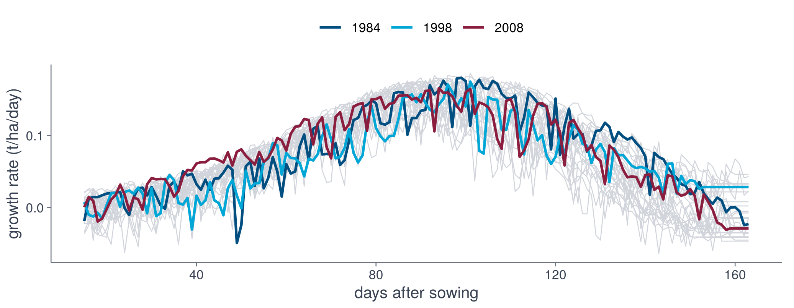
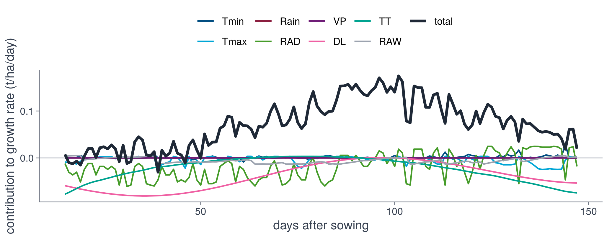
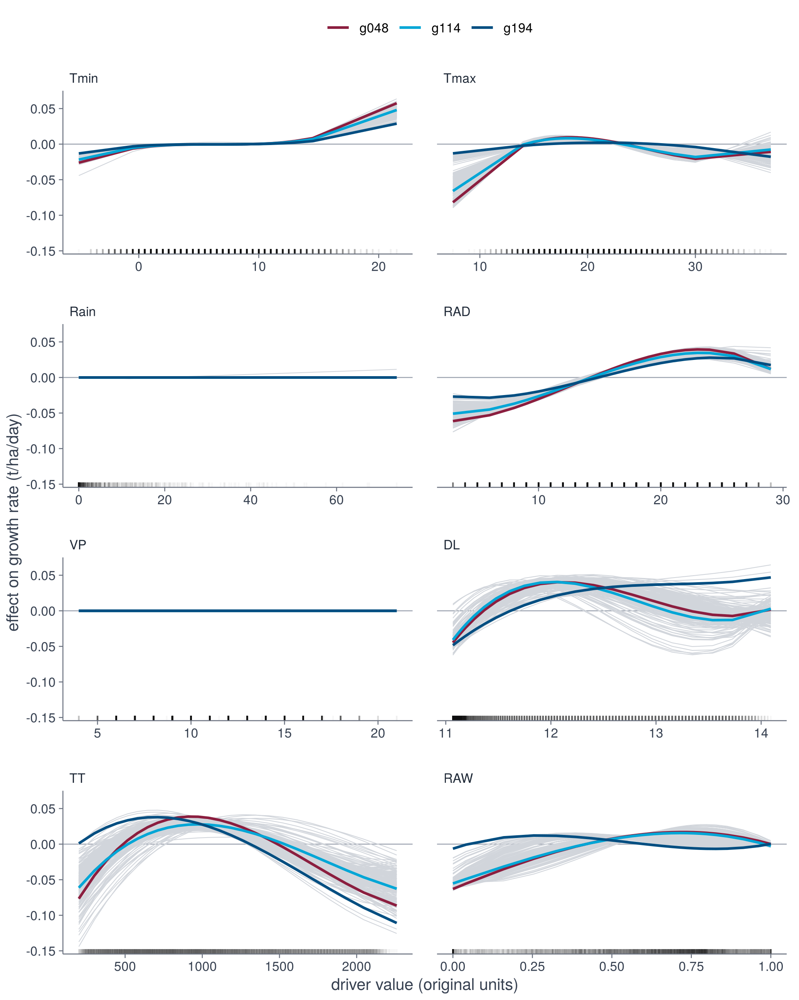

::: {.cell}

:::


This page continues from steps 2 and 3 and uses their objects `weather`, `traj`, `drv`, `Theta` and `tr`. To start here, load them as described on the [Set up](setup.html) page.


## Fitted equations

For interpretation, the sparse model (STLSQ) of every genotype is fitted to all years. The coefficients of genotype `g114` are

::: {.panel-tabset group="language"}

## R


::: {.cell}

```{.r .cell-code}
fit_genotype <- function(g) {
    design <- make_design(Theta, tr, g)
    fit_stlsq(design$Theta, design$dy)
}
coefs <- sapply(tr$genotypes, fit_genotype)
round(coefs[, "g114"], 4)
```
:::


## Python

```python
def fit_genotype(g):
    design = make_design(Theta, tr, g)
    return fit_stlsq(design.Theta, design.dy)

coefs = pd.DataFrame({g: fit_genotype(g) for g in tr.genotypes},
                     index=["1"] + Theta.terms)
print(coefs["g114"].round(4))
```

:::


::: {.cell}
::: {.cell-output .cell-output-stdout}

```
      1    Tmin  Tmin^2  Tmin^3    Tmax  Tmax^2  Tmax^3    Rain  Rain^2  Rain^3 
 0.1608  0.0000  0.0000  0.0014 -0.0099 -0.0056  0.0023  0.0000  0.0000  0.0000 
    RAD   RAD^2   RAD^3      VP    VP^2    VP^3      DL    DL^2    DL^3      TT 
 0.0338 -0.0061 -0.0041  0.0000  0.0000  0.0000 -0.0095 -0.0530  0.0237 -0.0205 
   TT^2    TT^3     RAW   RAW^2   RAW^3 
-0.0291  0.0086  0.0174 -0.0133 -0.0022 
```


:::
:::


Written out for `g114`, with the standardised drivers,

$$\begin{aligned} \frac{dy}{dt} &= 0.161 + 1.37\times 10^{-3}\,\mathrm{Tmin}^{3} - 9.89\times 10^{-3}\,\mathrm{Tmax} \\ &\quad - 5.57\times 10^{-3}\,\mathrm{Tmax}^{2} + 2.26\times 10^{-3}\,\mathrm{Tmax}^{3} + 0.0338\,\mathrm{RAD} \\ &\quad - 6.14\times 10^{-3}\,\mathrm{RAD}^{2} - 4.05\times 10^{-3}\,\mathrm{RAD}^{3} - 9.47\times 10^{-3}\,\mathrm{DL} \\ &\quad - 0.053\,\mathrm{DL}^{2} + 0.0237\,\mathrm{DL}^{3} - 0.0205\,\mathrm{TT} \\ &\quad - 0.0291\,\mathrm{TT}^{2} + 8.55\times 10^{-3}\,\mathrm{TT}^{3} + 0.0174\,\mathrm{RAW} \\ &\quad - 0.0133\,\mathrm{RAW}^{2} - 2.15\times 10^{-3}\,\mathrm{RAW}^{3} \end{aligned}$$

Individual coefficients of a polynomial are difficult to interpret, so the equation is examined through the growth rate it implies.

## Growth rate over the year

Predicted growth rate of genotype `g114` for the drivers of each year (grey) and of three selected years.

::: {.panel-tabset group="language"}

## R


::: {.cell}

```{.r .cell-code}
n_days <- dim(Theta)[2]
rate_y <- function(y) cbind(1, Theta[y, , ]) %*% coefs[, "g114"]
rates <- data.frame(
    das = rep(1:n_days + tr$das0 - 1, length(tr$years)),
    year = rep(tr$years, each = n_days),
    rate = unlist(lapply(seq_along(tr$years), rate_y))
)
rates <- rates[rates$das <= tr$das0 + max(tr$nend) - 1, ]
shown <- rates[rates$year %in% c(1984, 1998, 2008), ]

ggplot(rates, aes(das, rate, group = year)) +
    geom_line(colour = "#D1D5DB", linewidth = 0.3) +
    geom_line(data = shown, aes(colour = factor(year)), linewidth = 0.8) +
    scale_colour_dgxe("blue", "cyan", "burgundy") +
    labs(x = "days after sowing", y = "growth rate (t/ha/day)") +
    theme_dgxe() +
    legend_top()
```
:::


## Python

```python
b = coefs["g114"].to_numpy()
rate = b[0] + Theta.array @ b[1:]
rate = rate[:, :tr.nend.max()]
das = np.arange(rate.shape[1]) + tr.das0

fig, ax = plt.subplots(figsize=(7, 2.8))
ax.plot(das, rate.T, color=GREY, lw=0.3)
for year, colour in zip([1984, 1998, 2008], [BLUE, CYAN, BURGUNDY]):
    ax.plot(das, rate[list(tr.years).index(year)], color=colour, lw=1.2,
            label=year)
ax.legend(frameon=False)
ax.set_xlabel("days after sowing")
ax.set_ylabel("growth rate (t/ha/day)")
fig.tight_layout()
```

:::


::: {.cell}
::: {.cell-output-display}
{width=1036.8}
:::
:::


For this additive library the rate is a sum of one function per driver, so its contributions can be separated. For year 1998:

::: {.panel-tabset group="language"}

## R


::: {.cell}

```{.r .cell-code}
contribution <- function(driver) {
    terms <- grep(paste0("^", driver), dimnames(Theta)[[3]])
    Theta[match(1998, tr$years), , terms] %*% coefs[1 + terms, "g114"]
}
palette <- c("#014E81", "#00A6D6", "#8B1E3F", "#469C2A", "#6F1D77", "#EF60A3", "#00A390", "#9CA3AF", "#1F2937")
parts <- sapply(drv$drivers, contribution)
contributions <- data.frame(
    das = rep(1:n_days + tr$das0 - 1, ncol(parts) + 1),
    part = factor(
        rep(c(drv$drivers, "total"), each = n_days),
        c(drv$drivers, "total")
    ),
    value = c(parts, coefs[1, "g114"] + rowSums(parts))
)
contributions <- contributions[
    contributions$das <= tr$das0 + tr$nend["g114", match(1998, tr$years)],
]

ggplot(contributions, aes(das, value, colour = part, linewidth = part)) +
    geom_hline(yintercept = 0, colour = "#9CA3AF", linewidth = 0.3) +
    geom_line() +
    scale_colour_manual(values = palette) +
    scale_linewidth_manual(values = c(rep(0.6, ncol(parts)), 1.1)) +
    labs(x = "days after sowing", y = "contribution to growth rate (t/ha/day)") +
    theme_dgxe() +
    legend_top()
```
:::


## Python

```python
PALETTE = ["#014E81", "#00A6D6", "#8B1E3F", "#469C2A", "#6F1D77", "#EF60A3", "#00A390", "#9CA3AF", "#1F2937"]
year = list(tr.years).index(1998)
n = tr.nend[np.searchsorted(tr.genotypes, "g114"), year] + 1
parts = {}
for name in drv.drivers:
    cols = [i for i, t in enumerate(Theta.terms) if t.startswith(name)]
    parts[name] = Theta.array[year, :n][:, cols] @ b[1 + np.array(cols)]
parts["total"] = b[0] + sum(parts.values())
das = np.arange(n) + tr.das0

fig, ax = plt.subplots(figsize=(7, 2.8))
ax.axhline(0, color="#9CA3AF", lw=0.5)
for (name, y), colour in zip(parts.items(), PALETTE):
    ax.plot(das, y, color=colour, lw=2 if name == "total" else 1, label=name)
ax.legend(frameon=False, ncol=5, fontsize=7)
ax.set_xlabel("days after sowing")
ax.set_ylabel("contribution to growth rate (t/ha/day)")
fig.tight_layout()
```

:::


::: {.cell}
::: {.cell-output-display}
{width=1036.8}
:::
:::


## Effect of a single driver

The effect of one driver cannot be read by varying it alone while the others are held fixed, since the drivers are correlated in real weather:

::: {.panel-tabset group="language"}

## R


::: {.cell}

```{.r .cell-code}
observed <- as.data.frame(observed_points(drv, tr))
round(cor(observed), 2)
```
:::


## Python

```python
observed = observed_points(drv, tr)
print(observed.corr().round(2))
```

:::


::: {.cell}
::: {.cell-output .cell-output-stdout}

```
      Tmin  Tmax  Rain   RAD    VP    DL    TT   RAW
Tmin  1.00  0.48  0.26  0.02  0.80  0.46  0.42 -0.24
Tmax  0.48  1.00 -0.14  0.66  0.36  0.68  0.63 -0.59
Rain  0.26 -0.14  1.00 -0.20  0.31  0.01  0.01  0.11
RAD   0.02  0.66 -0.20  1.00 -0.08  0.74  0.72 -0.58
VP    0.80  0.36  0.31 -0.08  1.00  0.33  0.29 -0.03
DL    0.46  0.68  0.01  0.74  0.33  1.00  0.97 -0.67
TT    0.42  0.63  0.01  0.72  0.29  0.97  1.00 -0.65
RAW  -0.24 -0.59  0.11 -0.58 -0.03 -0.67 -0.65  1.00
```


:::
:::


Accumulated local effects (ALE) vary the driver only within narrow intervals around values that occur, using the observed values of the other drivers, and accumulate the resulting changes in the growth rate. For the fitted growth rate $f(\mathbf{u}) = \boldsymbol{\theta}(\mathbf{u})^\top \hat{\boldsymbol{\xi}}$ and driver $j$,

$$
\mathrm{ALE}_j(z) = \int_{z_0}^{z} \mathbb{E}\!\left[\frac{\partial f(\mathbf{u})}{\partial u_j} \,\middle|\, u_j = v\right] dv - c,
$$

where $z_0$ is the smallest observed value and the constant $c$ centres the curve at mean zero over the data.

::: {.panel-tabset group="language"}

## R


::: {.cell}

```{.r .cell-code}
predictor <- function(coef, pairs = FALSE) {
    rate <- function(model, newdata) {
        Theta_new <- library_matrix(as.matrix(newdata), pairs = pairs)
        as.vector(cbind(1, Theta_new) %*% model)
    }
    Predictor$new(coef, data = observed, predict.function = rate)
}

natural <- function(z, j) z * drv$scale[j] + drv$center[j]
ale_genotype <- function(g, j) {
    effect <- FeatureEffect$new(predictor(coefs[, g]), drv$drivers[j],
        method = "ale", grid.size = 24
    )$results
    data.frame(
        genotype = g, driver = factor(drv$drivers[j], drv$drivers),
        x = natural(effect[[drv$drivers[j]]], j), effect = effect$.value
    )
}
grid_cells <- expand.grid(
    g = tr$genotypes, j = seq_along(drv$drivers),
    stringsAsFactors = FALSE
)
curves <- do.call(rbind, Map(ale_genotype, grid_cells$g, grid_cells$j))
```
:::


## Python

```python
import logging

from PyALE import ale

logging.getLogger().setLevel(logging.WARNING)

def natural(z, j):
    return z * drv.scale[j] + drv.center[j]

def ale_genotype(g, j):
    rate = GrowthRate(coefs[g].to_numpy())
    effect = ale(observed, rate, [drv.drivers[j]], grid_size=24,
                 include_CI=False, plot=False)
    return pd.DataFrame({"genotype": g, "driver": drv.drivers[j],
                         "x": natural(effect.index.to_numpy(), j),
                         "effect": effect["eff"].to_numpy()})

curves = pd.concat(ale_genotype(g, j)
                   for g in tr.genotypes for j in range(len(drv.drivers)))
```

:::


::: {.cell}

:::


::: {.cell}

:::


The ALE curve of each driver for every genotype (grey), and for the genotypes with the lowest, median and highest final biomass:

::: {.panel-tabset group="language"}

## R


::: {.cell}

```{.r .cell-code}
highlighted <- c("g194", "g114", "g048") # lowest, median, highest final biomass
rug <- do.call(rbind, lapply(seq_along(drv$drivers), function(j) {
    data.frame(driver = factor(drv$drivers[j], drv$drivers), x = natural(observed[, j], j))
}))

ggplot(curves, aes(x, effect, group = genotype)) +
    geom_hline(yintercept = 0, colour = "#9CA3AF", linewidth = 0.3) +
    geom_line(colour = "#D1D5DB", linewidth = 0.25) +
    geom_line(
        data = curves[curves$genotype %in% highlighted, ],
        aes(colour = genotype), linewidth = 0.8
    ) +
    geom_rug(
        data = rug, aes(x = x), inherit.aes = FALSE, sides = "b",
        alpha = 0.03
    ) +
    facet_wrap(~driver, ncol = 2, scales = "free_x") +
    scale_colour_dgxe("burgundy", "cyan", "blue") +
    labs(
        x = "driver value (original units)",
        y = "effect on growth rate (t/ha/day)"
    ) +
    theme_dgxe() +
    legend_top()
```
:::


## Python

```python
highlighted = ["g194", "g114", "g048"]    # lowest, median, highest final biomass
fig, axes = plt.subplots(4, 2, figsize=(7.2, 9))
for j, (ax, name) in enumerate(zip(axes.flat, drv.drivers)):
    sub = curves[curves["driver"] == name]
    for g, c in sub.groupby("genotype"):
        ax.plot(c["x"], c["effect"], color=GREY, lw=0.25)
    for g, colour in zip(highlighted, [BURGUNDY, CYAN, BLUE]):
        c = sub[sub["genotype"] == g]
        ax.plot(c["x"], c["effect"], color=colour, lw=1.2, label=g)
    ax.plot(natural(observed[name], j), np.full(len(observed), ax.get_ylim()[0]), "|",
            color="k", alpha=0.03)
    ax.axhline(0, color="#9CA3AF", lw=0.5)
    ax.set_title(name, loc="left")
axes[0, 0].legend(frameon=False, fontsize=7)
fig.supylabel("effect on growth rate (t/ha/day)")
fig.tight_layout()
```

:::


::: {.cell}
::: {.cell-output-display}
{width=1036.8}
:::
:::


