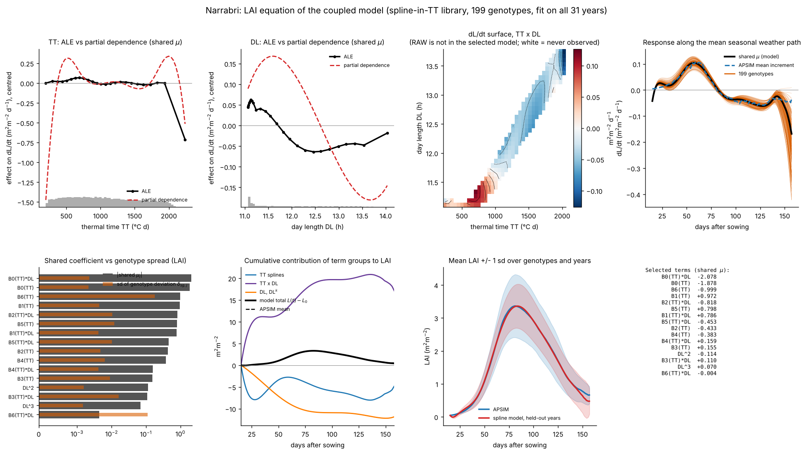
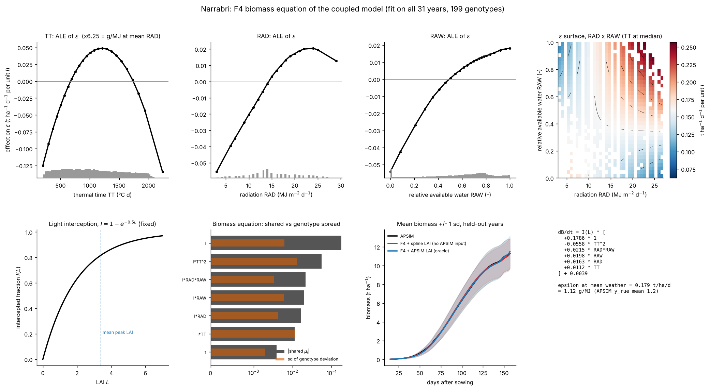

The numbers and figures on this page come from the research code (Python), not from the R functions of the previous steps, and are not reproduced in R.

## Coupled states

In steps 4 to 8 the growth rate depends on the weather but not on the state of the crop, so the solution is a cumulative sum. In a crop, a larger leaf area intercepts more light and increases biomass growth. A model with this feedback is a coupled system in leaf area index $L$ and biomass $B$,

$$
\frac{\mathrm{d}L}{\mathrm{d}t} = f_L(L, B, u_t), \qquad \frac{\mathrm{d}B}{\mathrm{d}t} = f_B(L, B, u_t),
$$

Because the state appears on the right-hand side, the solution requires numerical integration. The regression remains linear in the coefficients, so steps 3 and 4 apply unchanged, but errors in the states feed back into the rates.

## Physical terms in the library

A candidate term for biomass growth is the light intercepted by the canopy, $I = 1 - \exp(-0.5\,L)$, multiplied by radiation: $\mathrm{d}B/\mathrm{d}t \ni I \cdot \mathrm{RAD}$.

## Results at Narrabri

Final biomass RMSE of coupled variants (leave-one-year-out, t/ha):

| Model | Final biomass RMSE |
|---|---|
| Weather-only (the model in this workshop) | 0.749 |
| Coupled, biomass driven by its own fitted polynomial LAI | 2.25 |
| Same, driven by a spline LAI fitted from weather | 0.90 |
| Same, driven by the true APSIM LAI | 0.45 |

With the true LAI the biomass error is 0.45, below that of the weather-only model. When LAI has to be predicted from the weather, the error depends on the quality of the LAI model, and a poor LAI model (the polynomial) is worse than none, as in step 8.

## Response curves

Response curves of the fitted LAI and biomass equations (ALE, as in step 6):

{width=100%}

{width=100%}

## Further directions

- Other regression methods: any method with the signature `fit(A, b, ...)`. Bayesian regression with sparsity-inducing priors provides uncertainty for the coefficients at higher computational cost.
- Several sites: pooling sites adds variation in the weather.
- New genotypes: prediction for a genotype not used in fitting requires additional information about it, for example its parameter values. This is not treated here.
- Other responses: step 8 shows leaf area index as an example.

