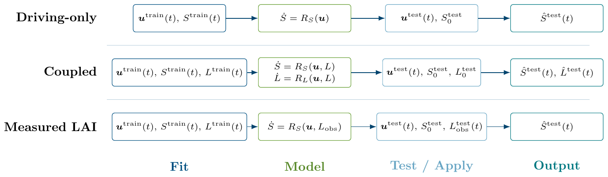

The numbers and figures on this page come from the research code (Python), not from the R functions of the previous steps, and are not reproduced in R.

## Coupled states

In steps 4 to 8 the library depends on the drivers only, so the solution is a cumulative sum. In a crop, a larger leaf area intercepts more light and increases biomass growth. Including the state in the library gives a coupled system in the leaf area index $L$ and the biomass $B$, with $\mathbf{y} = (L, B)$:

$$
\dot{L} = \boldsymbol{\theta}_L(\mathbf{y}, \mathbf{u})^\top \boldsymbol{\xi}_L, \qquad
\dot{B} = \boldsymbol{\theta}_B(\mathbf{y}, \mathbf{u})^\top \boldsymbol{\xi}_B .
$$

The regression is unchanged, with the observed states in the library. The solution requires numerical integration, and errors in the states feed back into the rates.

{width=100%}

## Physical terms in the library

A candidate term for biomass growth is the light intercepted by the canopy, $I = 1 - \exp(-0.5\,L)$, multiplied by radiation: $\mathrm{d}B/\mathrm{d}t \ni I \cdot \mathrm{RAD}$.

## Results at Narrabri

Final biomass RMSE of coupled variants (leave-one-year-out, t/ha). In the research code the genotypes were fitted jointly, with shared coefficients and genotype-specific deviations; fitting each genotype separately, as in this workshop, gives a similar error (0.76 t/ha at maturity for the weather-only model).

| Model | Final biomass RMSE |
|---|---|
| Weather-only (the model in this workshop) | 0.749 |
| Coupled, biomass driven by its own fitted polynomial LAI | 2.25 |
| Same, driven by a spline LAI fitted from weather | 0.90 |
| Same, driven by the true APSIM LAI | 0.45 |

With the true LAI the biomass error is 0.45, below that of the weather-only model. When LAI has to be predicted from the weather, the error depends on the quality of the LAI model, and a poor LAI model (the polynomial) is worse than none, as in step 8.

## Response curves

Response curves of the fitted LAI and biomass equations (ALE, as in step 6):

{width=100%}

{width=100%}

## Further directions

- Other regression methods: any method with the signature `fit(X, dy)`. Bayesian regression with sparsity-inducing priors provides uncertainty for the coefficients at higher computational cost.
- Several sites and joint fitting of genotypes: coefficients shared between genotypes, with genotype-specific deviations, use the data of all genotypes for each equation. Pooling sites adds variation in the weather.
- New genotypes: prediction for a genotype not used in fitting requires additional information about it, for example its parameter values. This is not treated here.
- Other responses: step 8 shows leaf area index as an example.

